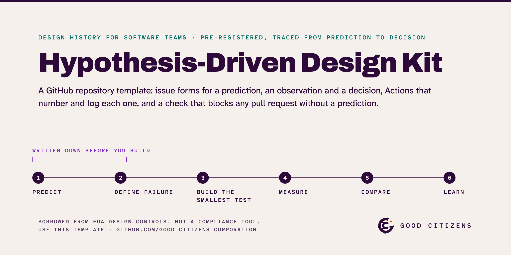

# Hypothesis-Driven Design Kit

**Designing for AI starts with an eval.** A model never gives the same answer twice, so you can't draw the right one. What you can write down is what a good answer must do, what fails it, and how often it has to pass, before anyone touches the prompt. If you've ever written down what would prove a design wrong, you already know how.

This kit is a GitHub repository template: three issue forms, the GitHub Actions that number and log each one, and a check that won't merge a pull request without a prediction. Your team writes down what it expects before it builds, and the results get compared with what you wrote, not with what you remember.

**[Use this template](https://github.com/Good-Citizens-Corporation/hypothesis-driven-design-kit/generate)** · [The kit on one page](https://good-citizens-corporation.github.io/hypothesis-driven-design-kit/)

## Start

1. Use the template to make your own copy of this repository.
2. Open a new issue, choose **Prediction**, and fill it in: what you expect, the number that settles it, and what would prove you wrong. It's given a number, `PRE-001`.
3. Name that number in the pull request that builds the test. A pull request that names no prediction can't be merged.

The rows already in `evidence-packet/` are the kit's own record. Clear them, keeping each file's header row, once you've copied it.

## What's in it

| Form | Gets | What it records |
| --- | --- | --- |
| Prediction | `PRE-001` | What you believe will happen, the number that will settle it, and the result that would prove you wrong. Sent before any work starts. |
| Observation | `OBS-001` | What you saw: a session with a customer, a test result, a pull from your analytics. Points to the prediction it bears on. |
| Decision | `DEC-001` | What you decided and why, and how the prediction ended: it held, it was proved wrong, it was dropped, or we couldn't tell. That closes the prediction in the log. |

**The check.** `require-preregistration.yml` fails any pull request whose description names no prediction in the log.

**The log.** One spreadsheet file per form in `evidence-packet/`: `pre_registrations.csv`, `observation_events.csv`, `decision_log.csv`. Open them in anything.

**The trace.** Because every form and pull request names the prediction it serves, the numbers join up by themselves: from what you expected, to what you built, to what you saw, to what you decided. `evidence-packet/trace_matrix.csv` is rebuilt after every form and every merged pull request, so nobody keeps it by hand.

Track the work itself wherever you already do: GitHub, Jira or Linear.

## Designing for AI

A design spec used to describe the one right output. A model gives a different answer every time, so the spec has to describe a range: what every good answer does, what no answer may do, and the share that has to pass. That's an eval, and product teams have started treating it as the spec itself ([Mind the Product, July 2026](https://www.mindtheproduct.com/evals-are-the-new-prd/)).

The forms map onto eval work: the prediction is the eval, each observation is an eval run, and the decision is the call to ship, change the prompt or change the model. The kit records evals; it doesn't run them. Asking the model the questions and scoring the answers takes a test harness, which you bring.

## The rules

- **Predict before you look.** A prediction written after the results is a story. Before, it's a test.
- **Say what would prove you wrong.** If no result could, it's a belief.
- **Being wrong counts.** A prediction proved wrong is a finding. Log the surprises; they're worth the most.

None of this is new, on purpose. Programmers write the failing test before the code, scientists pre-register studies, Lean UX writes design as hypotheses, and medical device makers keep a design history file that traces every design input to its verification. What the kit adds is the habit made hard to skip.

**Borrowed from FDA design controls, it is not a compliance tool:** it has no signed approvals or change control, and its records are files anyone with access to the repository can edit.

## Why this exists

I've spent the 2020s surrounded by robots and glass: kiosks, chatbots and touchscreens that turn every errand into self-service. It's isolating. And most of it reaches us as an open beta. It ships first and finds out later whether it works, and the people using it are the test.

It doesn't have to be built that way. Write down what you expect before you ship, and what would prove you wrong. Try it on a few people who agreed to be asked, not on everyone. This kit is the smallest proof I could give away: a form, a check and a log, so nobody has to be a test subject who didn't sign up.

— [Robert Duebelbeis](https://get-a-bob.com/experience), [Good Citizens](https://goodcitizens.us)

## Also here

- `hypothesis-driven-design.skill` and `skill-update/`: an agent skill that turns briefs, PRDs and decks into predictions in this format. How to use it: [docs/COPILOT_SKILL.md](docs/COPILOT_SKILL.md).
- `.github/scripts/`: the logic the workflows share, with its tests (`node --test .github/scripts/evidence.test.js`).

Not on GitHub? The method doesn't need it. A spreadsheet with three tabs, one per form, does the same job.
